WebGL Forward+ and Clustered Deferred Shading
======================

**University of Pennsylvania, CIS 565: GPU Programming and Architecture, Project 4**

* Yikai Li
* Tested on: **Google Chrome 155.0.8059.84** on Windows 11 Home 25H2, AMD Ryzen AI 9 365 (10 cores), 32 GB RAM, NVIDIA GeForce RTX 5080 Laptop GPU 16 GB (Personal Computer), 2560 x 1305 canvas

### Live Demo

[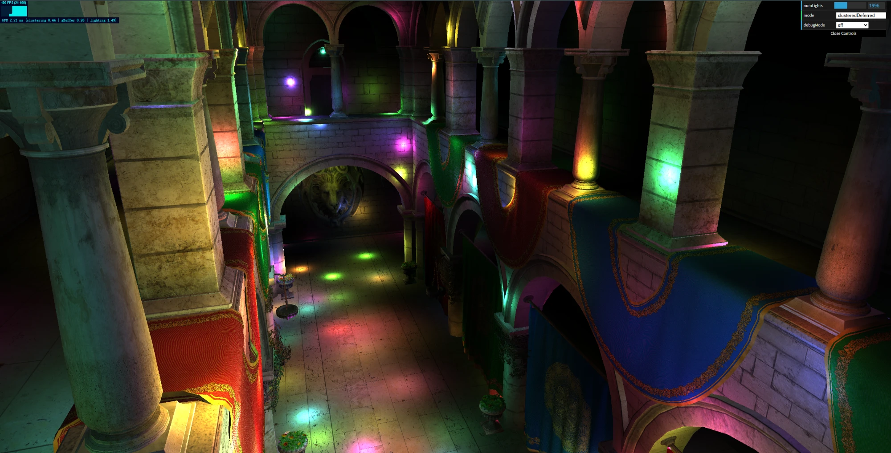](https://sqqqqqqs.github.io/Project4-WebGPU-Forward-Plus-and-Clustered-Deferred)

### Demo Video/GIF

Click to watch on YouTube. The video shows:

- **Naive → Forward+ → Clustered Deferred** at 500 lights, with the per-pass GPU time (top left) dropping at each step
- **5000 lights** while flying through the scene, still running smoothly with clustering
- The **extra credit modes**: Forward+ with depth prepass and with cluster culling, then deferred with compute lighting and with the packed G-buffer
- The three **debug views**: cluster index, z slices, and lights per cluster

## Features

A WebGPU renderer for the Sponza atrium lit by up to 5000 moving point lights. Instead of every pixel checking every light, the view frustum is split into clusters and each pixel only shades with the lights of its own cluster, in both a Forward+ and a Clustered Deferred pipeline.

**Required**
- **Naive** forward renderer with the camera view-projection uniform.
- **Forward+**: a compute shader splits the view frustum into 32 x 18 x 48 clusters (one near slice, then logarithmic depth slices), assigns each light to the clusters its sphere overlaps, and the fragment shader only loops over its own cluster's lights.
- **Clustered Deferred**: reuses the same light clustering; a G-buffer pass writes albedo + normal (+ depth), then a fullscreen pass reconstructs world position from depth and shades each pixel once.

**Extra credit**
- **G-buffer optimization** (+10): lighting runs in a single compute pass that writes straight to the canvas, and the G-buffer is packed into **one `rg32uint` texture (8 bytes/pixel)**: `pack4x8unorm` albedo + octahedron-encoded normal as `pack2x16snorm`. Position comes from the depth buffer.
- **Depth prepass for Forward+** (+15): overdraw-free shading (+5) and depth-based cluster culling (+10).

**Render modes** in the GUI: `naive`, `forward+`, `clustered deferred` (required), and `forward+: depth prepass`, `forward+: prepass + cluster culling`, `deferred: compute lighting`, `deferred: compute + packed G-buffer` (extra credit).

**Tools for the analysis**
- Debug views (GUI `debugMode`): cluster index, z slice, lights per cluster (heatmap, white = cluster full), and the G-buffer contents from the recitation (albedo, normal, depth, position). The position view in Clustered Deferred is rebuilt from depth while Forward+ shows the interpolated vertex position, so the two matching checks the depth reconstruction.
- Per-pass GPU timing with timestamp queries, shown on screen (top left). Every pass passes `timestampWrites` from a small `GpuTimer` ([`src/gpu_timer.ts`](src/gpu_timer.ts)), and the renderers call `this.submit(encoder)` (in the base `Renderer`) instead of `device.queue.submit()`, which resolves the queries and reads them back after submitting.

| Cluster index | Z slices (log) | Lights per cluster |
|---|---|---|
| 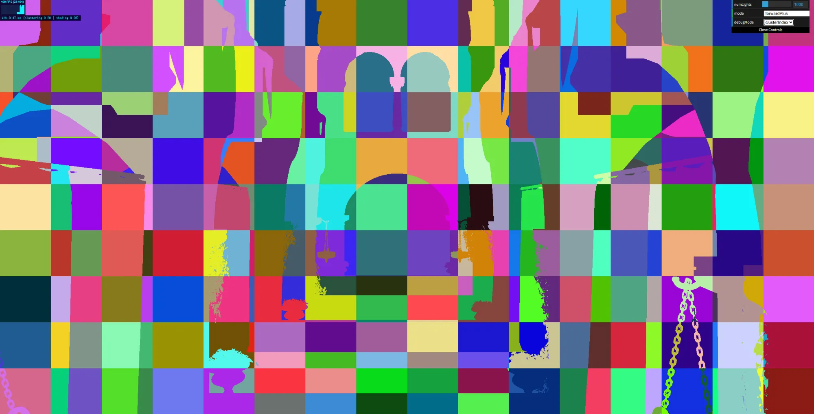 |  | 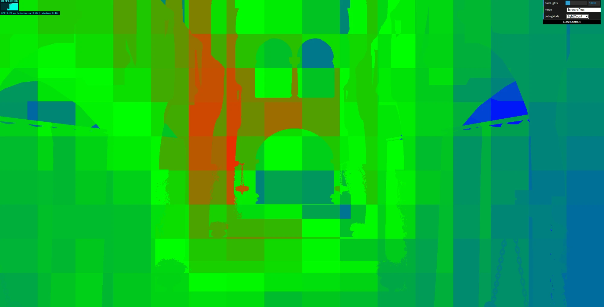 |

| Albedo | Normal | Depth | Position |
|---|---|---|---|
| 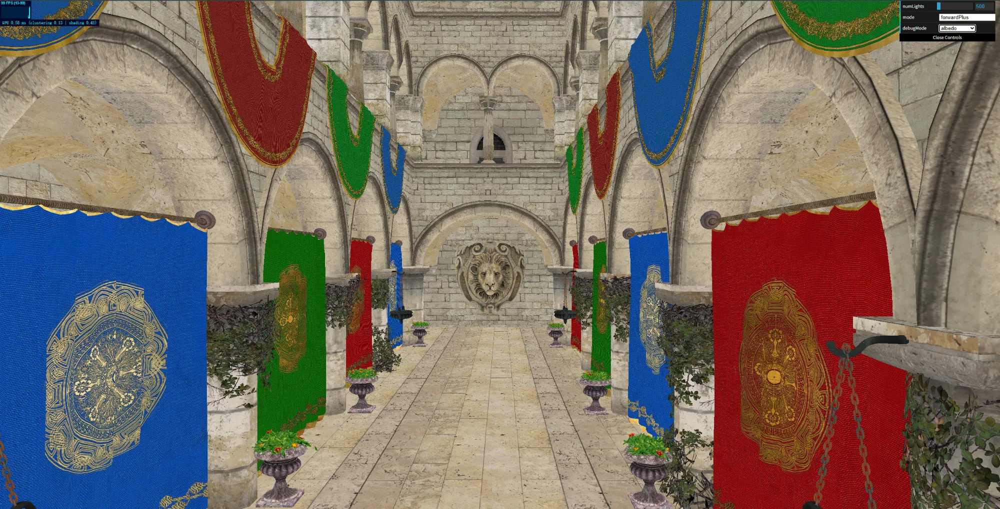 | 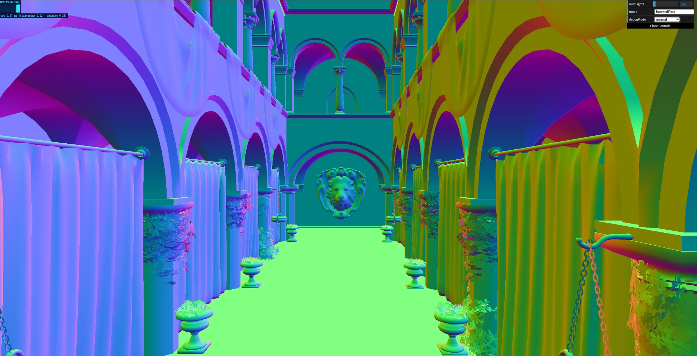 | 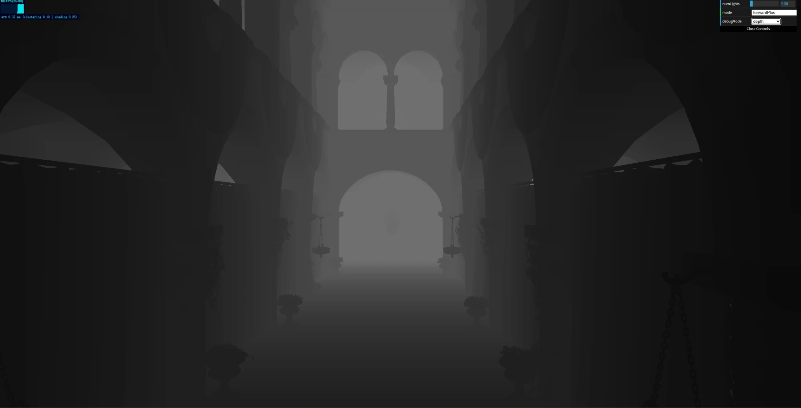 | 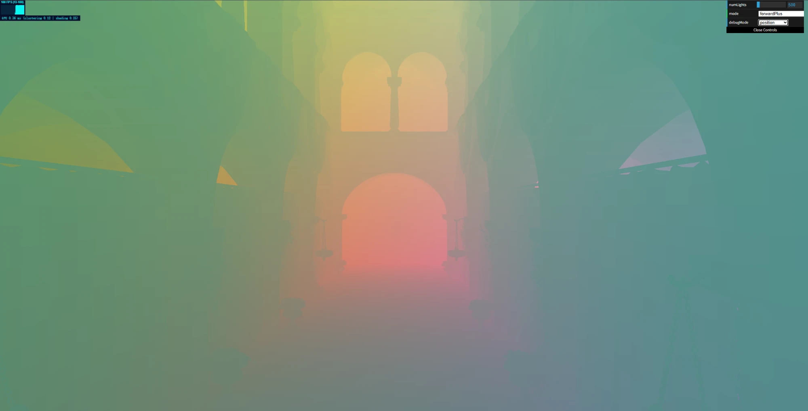 |

The lights-per-cluster view (blue = few, green, red = many, shown with 1000 lights) maps directly to shading cost: each pixel loops over exactly that many lights, so the red regions are where the shading/lighting pass spends its time. Clusters grow with distance (log slicing + perspective), so large mid-distance clusters inside the volume the lights move in collect the most lights, while the far end of the hall, outside that volume, gets few.

## Performance Analysis

All numbers are GPU time in ms measured with timestamp queries, averaged over ~5 s per configuration from the default camera view. Unless noted otherwise they were measured with the original 16 x 9 x 24 grid and plain log slicing; the default grid was changed afterwards based on the grid experiment below. Within each chart or table, all results come from the **same** run; absolute numbers vary somewhat between runs (laptop GPU clocks), so compare within a chart.

### Forward+ vs. Clustered Deferred

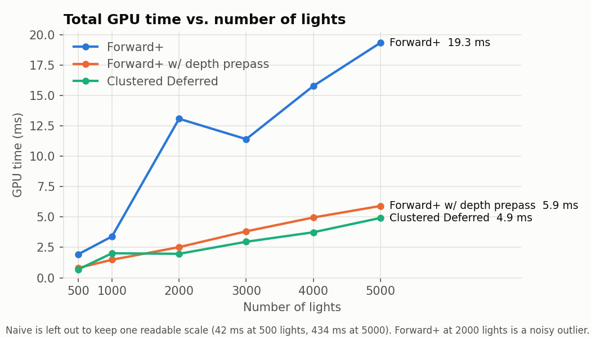

| Lights | Naive | Forward+ | Forward+ w/ prepass | Clustered Deferred |
|---|---|---|---|---|
| 500 | 42.2 | 1.94 | 0.81 | 0.70 |
| 1000 | 139.9 | 3.40 | 1.48 | 2.02 |
| 3000 | 249.6 | 11.40 | 3.82 | 2.96 |
| 5000 | 434.2 | 19.33 | 5.91 | 4.92 |

*(Naive from a separate run. At 100–400 ms per frame it only got a handful of samples, so it is noisy.)*

- **Clustering gives ~20x over Naive**: each fragment checks only the lights of its cluster instead of all of them.
  - **Best case**: small light radius and lights spread out, so each cluster only overlaps a few of them. **Worst case**: a large radius or lights bunched together, so most clusters overlap most lights and it falls back toward Naive, plus the cost of clustering and of overflowing clusters dropping lights.
- **Clustered Deferred is ~4x faster than Forward+** with many lights, even though the lighting code is identical. The difference is **overdraw**: Forward+ runs the full light loop for every rasterized fragment, including the ones that end up hidden, while Deferred shades each screen pixel exactly once.

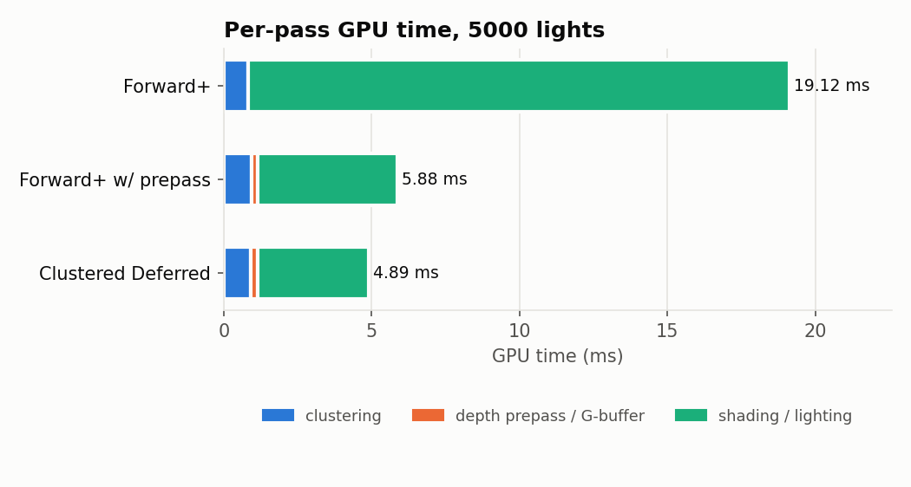

The breakdown shows it directly: Forward+'s shading pass (18.3 ms) costs ~4.9x Deferred's lighting pass (3.7 ms), which means Sponza has roughly **4–5 layers of overdraw** from this view (a rough estimate, since Forward+ fragments also do a bit of extra work like texture sampling). Deferred pays a fixed ~0.23 ms for the G-buffer pass regardless of light count, so the gap shrinks with few lights.

**Tradeoffs.** Deferred wins for heavy lighting with high depth complexity. Forward+ needs no G-buffer (less memory and bandwidth), supports MSAA and transparency, and allows any material per object, which a fixed G-buffer layout does not.

### Cluster grid size

The grid can be changed with a URL parameter (`?clusters=32x18x48`) to compare three grids from the same view (the coarse grid also used `&maxLights=4096` since its big clusters overflow 1024):

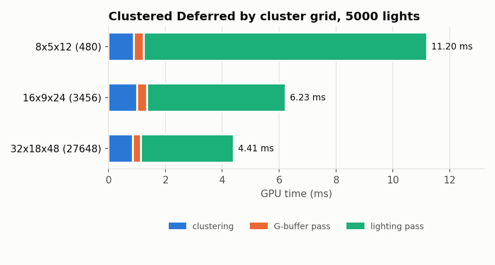

| Grid (clusters) | Tile size | Clustering pass | Deferred lighting pass | Deferred total |
|---|---|---|---|---|
| 8x5x12 (480) | 320 x 261 px | 0.89 | 9.95 | 11.39 |
| 16x9x24 (3456) | 160 x 145 px | 1.01 | 4.88 | 6.29 |
| 32x18x48 (27648) | 80 x 73 px | 0.86 | 3.26 | 4.46 |

*(5000 lights.)*

- **Finer grids make shading much cheaper**: smaller clusters overlap fewer lights, so each pixel loops over fewer of them (lighting pass 9.95 → 3.26 ms).
- **The clustering pass stays flat (~0.9 ms) even with 58x more clusters.** Each thread still loops over all lights, and even 27648 threads (~860 warps) all run at the same time on this GPU, so the pass takes as long as one thread's loop no matter how many clusters there are.
- So on this GPU the finer grid is better, and **32 x 18 x 48 is now the default**. The limit is memory: with fixed-size light lists, the 32x18x48 cluster buffer is 113 MB, close to WebGPU's default 128 MB storage binding limit.

### Depth prepass for Forward+ (extra credit)

A depth-only pass (with the alpha test, so the plants' cutouts stay transparent) fills the depth buffer, then the shading pass uses `depthCompare: "equal"` with depth writes off, so only the visible fragment of each pixel is shaded. `@invariant` on the position makes both passes produce bit-identical depth, and the shading pass skips its `discard` (via a pipeline-overridable constant) so early-Z is not disabled.

- **Shading 18.3 → 4.7 ms (3.9x)** at 5000 lights for a ~0.2 ms prepass that doesn't depend on the light count. Total frame **2.4x–3.3x faster**, more with more lights since each skipped fragment is more expensive.
- Still ~20% slower than Deferred: geometry is rasterized twice and 2x2 pixel quads along the many small triangle edges get shaded partially (Deferred's fullscreen triangle has no such quads).
- **Best case**: high overdraw + expensive shading + cheap geometry (this scene). **Worst case**: dense geometry with little overdraw, where drawing everything twice costs more than it saves.

### G-buffer optimization (extra credit)

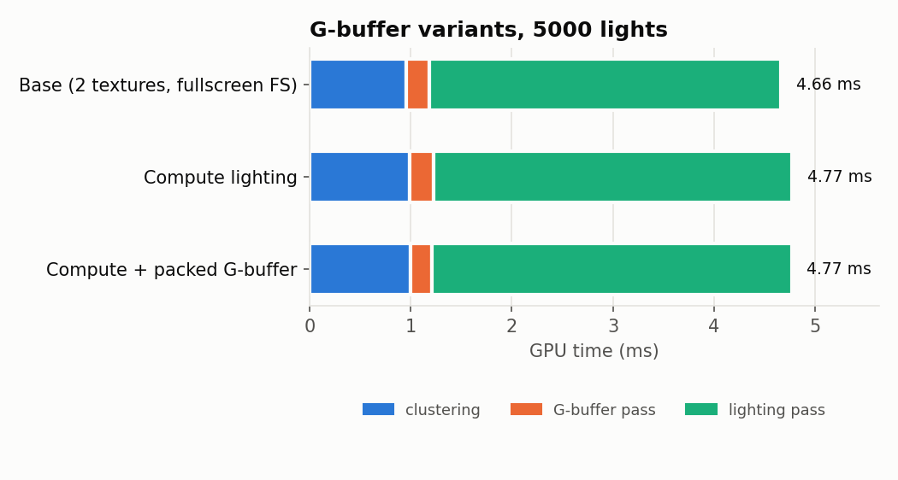

- Packing (12 → 8 bytes/pixel, 2 color targets → 1) makes the **G-buffer pass ~9% faster** (0.23 → 0.21 ms).
- Compute vs. fullscreen fragment lighting: **no measurable difference** (within ±2%).
- **Tradeoffs**: normals are quantized to 2 x 16 bits (octahedron encoding keeps the error evenly spread and well below anything visible), packing/unpacking costs a few ALU ops, and writing to the canvas as a storage texture requires an `rgba8unorm` canvas instead of the preferred format.
- **Why so little**: the lighting pass is bound by the per-pixel light loop, not by reading the G-buffer. Reading a few tens of MB per frame takes only hundredths of a millisecond on this GPU. These optimizations matter more at high resolution or on bandwidth-limited GPUs (integrated/mobile).
- **Further optimization**: use the compute pass for something a fragment shader can't do. Pixels in an 8x8 workgroup almost always share a cluster, so the workgroup could load that cluster's light list into shared memory once instead of every thread reading it from global memory (tile-based deferred).

### Depth-based cluster culling (extra credit)

After the depth prepass, a fullscreen pass reads the depth buffer (attached read-only so it can also be sampled), computes each pixel's cluster and marks it active (no atomics needed since every writer stores the same value). The clustering compute shader then skips inactive clusters. I used the **simple skip** approach, not stream compaction.

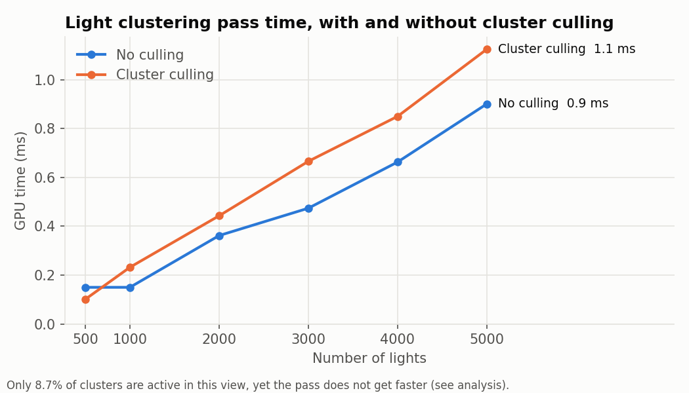

- Only **8.7% of clusters are active** in this view (`await countActiveClusters()` in the console) and the marking pass costs only 0.03 ms, but the **clustering pass does not get faster** (0.90 → 1.13 ms at 5000 lights).
- **Why**: the clustering kernel is **latency-bound, not throughput-bound**. 3456 clusters is only ~108 warps, which the GPU runs all at once, so the pass takes as long as the slowest thread looping over all 5000 lights. Skipping clusters removes threads that were running in parallel anyway; it doesn't shorten the longest loop.
- **Why it is even slower**: with most warps gone, each SM has very few warps left to switch between while one waits on a memory read of a light, so the memory latency is no longer hidden and each remaining loop runs slower.
- **I expected culling to pay off with a finer grid, but it doesn't**: at 32x18x48 only 4.4% of clusters are active, yet clustering goes from 1.30 to 2.17 ms (5000 lights). As the grid experiment above shows, even 27648 clusters fit on the GPU at once, so the same two effects apply.
- **Stream compaction would not help either**: fewer warps, same loop length per thread, and even less latency hiding.
- **What would make culling pay off**: a clustering kernel that parallelizes over lights (e.g. one workgroup per cluster, where 64 threads split the light loop). Then the work per cluster is spread across many threads, the number of launched workgroups is what costs time, and skipping 91–96% of them would cut it accordingly. A much smaller GPU (fewer SMs) would also reach that point sooner.

### Other notes

- **Cluster depth range** is hard-coded to 0.1–40 instead of the camera's far plane (1000), as the recitation allows: Sponza is ~35 units across, so with 1000 most log slices would be wasted outside the scene. Anything farther than 40 falls into the last slice, which only matters if the camera leaves the building.
- **Near slice**: with plain log slicing, 0.1–1 takes up log(10) / log(400) ≈ 38% of the slices, right in front of the camera where there's hardly any geometry. Slice 0 now covers all of 0.1–1 by itself and the other 47 are log spaced over 1–40, so they're spent where the scene actually is (same idea as the special near slice in id Software's Doom 2016 clustered renderer).
- **Max lights per cluster** started at 512, but the heatmap showed full (white) clusters at 5000 lights, which silently drops lights, so it was raised to 1024. After the switch to 32 x 18 x 48 I read the cluster buffer back to check again (at the 2560 x 1305 aspect ratio, 5000 lights): the fullest cluster had ~770 lights, so 512 still overflows (up to ~1900 full clusters) and 1024 stays, making the cluster buffer 113 MB. A global light index list with per-cluster offsets would use memory proportional to the actual light count instead.
- **Production build fix**: the deployed site first rendered black because every shader failed to compile with `undefined` in place of `lightRadius`, `clusterNear` and `clusterFar`. `evalShaderRaw()` in `shaders.ts` read the constants through `eval`, so the production build couldn't see that the shaders use them and dropped the properties only shaders read (`lightRadius` from the base code included). It now passes the object into `new Function(...)` explicitly, which keeps every property. `npm run dev` never showed it since it doesn't minify.
- **Timestamp quirk**: on Chrome/D3D12, the Forward+ shading pass returned 0 for its timestamps while its depth attachment used `depthStoreOp: "discard"`. Switched it to `"store"`.

## Changes after testing

Everything above was tested accordingly. These changes came after the analysis testing:

- **Fix: live demo rendered black** (commit `page fix`). The production build dropped the shader-only constants, see "Production build fix" above. This only touched `evalShaderRaw()` in `shaders.ts` and didn't change any rendering logic.
- **Improvement: default cluster grid and near slice.** Based on the grid experiment, the default grid went from 16 x 9 x 24 to 32 x 18 x 48, and z slice 0 now covers 0.1–1 by itself (see "Near slice" above). The performance numbers in this README were measured before this change, with the original grid.

## Credits

Libraries (from the base code):

- [Vite](https://vitejs.dev/)
- [loaders.gl](https://loaders.gl/)
- [dat.GUI](https://github.com/dataarts/dat.gui)
- [stats.js](https://github.com/mrdoob/stats.js)
- [wgpu-matrix](https://github.com/greggman/wgpu-matrix)

Techniques referenced:

- Octahedron normal encoding: Cigolle et al., [A Survey of Efficient Representations for Independent Unit Vectors](https://jcgt.org/published/0003/02/01/), JCGT 2014
- PCG integer hash used to color the cluster debug view: Jarzynski & Olano, [Hash Functions for GPU Rendering](https://jcgt.org/published/0009/03/02/), JCGT 2020
- Clustered shading: Olsson et al., [Clustered Deferred and Forward Shading](https://www.cse.chalmers.se/~uffe/clustered_shading_preprint.pdf), HPG 2012
